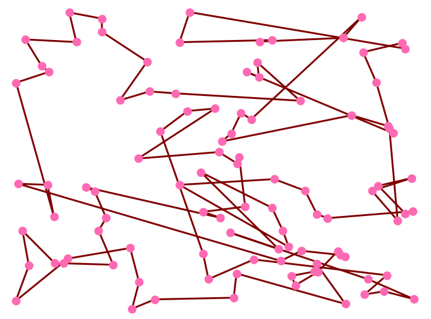
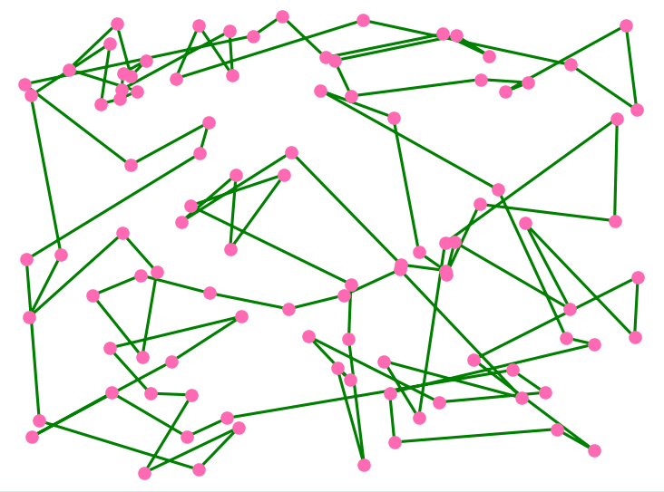
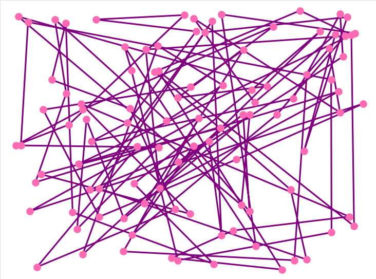
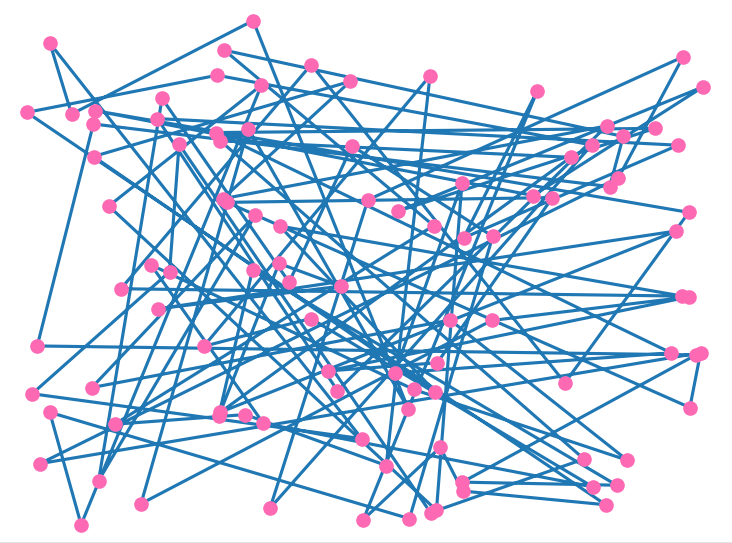
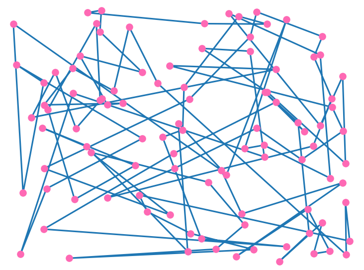

# Travelling Salesman Problem Optimiser

## Run Instructions

- Download the repo
- `pip install -r requirements.txt`
- `python travelling_salesman.py`
- For animations, call the `animate_all()` function inside `travelling_salesman.py`

# Overview

The Travelling Salesman Problem (TSP) is an incredibly famous combinatorial optimisation problem. Given a set of points ("cities"), the problem is to find the shortest route which visits all cities and returns to the first. With $n$ cities and symmetry considered, the number of possible tours is $\frac{(n-1)!}{2}$, and so a brute force approach has factorial complexity and is infeasible with any significant number of cities. The TSP is NP-hard, meaning that finding an optimal solution is at least as computationally difficult as solving any problem in NP. No polynomial-time algorithm for solving it exactly is currently known (unless P = NP). However, there are many *heuristic* algorithms which attempt to find a very good (not necessarily optimal) solution in a fraction of the time it would take to brute force. This project implements five of these:

# Algorithms

### (Best Improvement) 2-Opt

This is one of the simplest TSP heuristics. Very simply, it picks two edges, and if redrawing the edges improves the solution, it proceeds as such.

![[Pasted image 20261120130641.png|439]]
My implementation greedily iterates over every pair of edges and then switches the two which shorten the tour the most. It halts once no more such moves are possible.

### 3-opt

This is similar to 2-opt, but instead of picking a pair of edges, it picks a group of three, and deletes all three of these edges. There are now 8 distinct ways (including the original) to redraw these to preserve the property of being a complete tour. My implementation randomly generates groups of three edges, and finds the way to redraw these (out of the possible 8) which minimises the total tour distance. It repeats this random selection until no improvements have been made in the last 20,000 attempted moves.

### 2-Opt Simulated Annealing

Simulated annealing (SA) is an optimisation algorithm which involves setting an initially high temperature, and making discrete 'steps' in the solution space. If the current step reduces the objective function (tour length), then it is accepted - if it does not, it is accepted with a probability dependent on the temperature:

$$P(\text{accept}) = \begin{cases} 1 & \Delta E < 0\\
e^{-\Delta E/T} & \Delta E \geq 0 \end{cases}$$

Where $T$ is the current temperature, and $\Delta E$ is the change in objective function produced by the current step.

The algorithm then slowly 'cools' the temperature, which has the effect of accepting fewer unproductive moves. It is founded in the hope that a slow cooling schedule allows greater exploration of solution space, and increases the probability that the algorithm finishes at a global minimum.

I will leave out the details of implementation in this README, but it is very similar to how I implemented SA in my `rastrigin-optimiser` project.

This implementation runs a simulated annealing algorithm, with the 'step' defined as a random 2-opt move.

### 3-Opt SA

This is identical to 2-opt SA, but the 'step' is a random 3-opt move (redrawn optimally).

### Lin-Kernighan

This is a fiendishly complex heuristic algorithm developed by Shen Lin and Brian Kernighan, which is very effective at finding near-optimal solutions to the TSP. I will not go into details here - the implementation is based on the variable-depth edge-exchange approach described in the original [Lin-Kernighan paper](https://www.cs.princeton.edu/~bwk/btl.mirror/tsp.pdf).
Broadly speaking, it can be thought of as a $k$-opt algorithm, which adaptively chooses the depth of its edge exchanges based on whether they can produce an improvement. This was by far the trickiest algorithm to implement.

# Visualisations

I used the matplotlib library to visualise the five algorithms at work, to give a better idea of how they operate. 

### 2-opt:

### 3-opt:

### 2-opt SA:

### 3-opt SA:

### Lin-Kernighan:

# Benchmarking

I benchmarked the five algorithms across 10, 25, 50, 75, and 100 cities to compare average solution quality and runtime. The same randomly generated cities and initial tours were used across all algorithms to ensure fairness, and all runtimes were measured on one machine with an AMD Ryzen 7 CPU. The results were averaged over 10 runs, each with a different configuration of cities.

# Results

#### 10 cities (initial tour length: 480.51)

|Algorithm|Final tour length|Improvement (%)|Time (s)|
|---|---|---|---|
|2-opt|280.10|41.71|0.0004|
|3-opt|276.58|42.44|0.3434|
|2-opt SA|276.25|42.51|4.3870|
|3-opt SA|276.25|42.51|15.5039|
|Lin-Kernighan|276.25|42.51|0.2806|

#### 25 cities (initial tour length: 877.46)

|Algorithm|Final tour length|Improvement (%)|Time (s)|
|---|---|---|---|
|2-opt|357.80|59.22|0.0061|
|3-opt|352.95|59.78|0.4157|
|2-opt SA|351.47|59.94|4.2687|
|3-opt SA|351.49|59.94|15.1363|
|Lin-Kernighan|352.50|59.83|0.9308|

#### 50 cities (initial tour length: 1464.75)

|Algorithm|Final tour length|Improvement (%)|Time (s)|
|---|---|---|---|
|2-opt|440.80|69.91|0.0402|
|3-opt|431.50|70.54|0.4638|
|2-opt SA|429.10|70.70|4.1230|
|3-opt SA|426.03|70.91|14.4179|
|Lin-Kernighan|429.00|70.71|2.1005|

#### 75 cities (initial tour length: 2105.60)

|Algorithm|Final tour length|Improvement (%)|Time (s)|
|---|---|---|---|
|2-opt|513.63|75.61|0.1555|
|3-opt|503.56|76.08|0.5701|
|2-opt SA|496.50|76.42|4.4163|
|3-opt SA|492.39|76.62|14.8054|
|Lin-Kernighan|496.94|76.40|4.8716|

#### 100 cities (initial tour length: 2723.77)

| Algorithm     | Final tour length | Improvement (%) | Time (s) |
| ------------- | ----------------- | --------------- | -------- |
| 2-opt         | 575.10            | 78.89           | 0.3623   |
| 3-opt         | 568.35            | 79.13           | 0.6294   |
| 2-opt SA      | 555.13            | 79.62           | 4.5530   |
| 3-opt SA      | 550.05            | 79.81           | 14.8056  |
| Lin-Kernighan | 555.23            | 79.62           | 8.4816   |

# Conclusions

**Summary**:
- All algorithms substantially improve the initial random tour.
- Best-improvement 2-opt is consistently the fastest.
- 3-opt SA produces the best solutions in experiments, but has the highest runtime.
- Lin-Kernighan compromises between solution quality and runtime, but its runtime increases significantly with problem size.

There are many conclusions which can be drawn from this data. Firstly, between algorithms, as the number of cities increased, the trend in solution quality became:

2-opt → 3-opt → 2-opt SA → Lin-Kernighan → 3-opt SA

Unsurprisingly, the general trend was that more complex heuristic algorithms produced higher quality solutions. The only exception to this was the Lin-Kernighan heuristic being outperformed by 3-opt SA - unsurprising, but more believable after inspecting the runtimes. The trend in runtimes, from quickest to slowest, was:

2-opt → 3-opt → Lin-Kernighan → 2-opt SA → 3-opt SA

Which interestingly, is similar to the ranking of solution quality. This is somewhat expected - it makes sense that the algorithms which take longer to run tend to produce solutions of a higher quality. The ordering showing is also expected - SA is a very long process, due to the guided random walk nature of its implementation.

All five algorithms ultimately ended up producing similar results, with stark differences in the runtime, so if compute is a bottleneck, it is perhaps a wiser decision to pick one of the more primitive heuristics.
